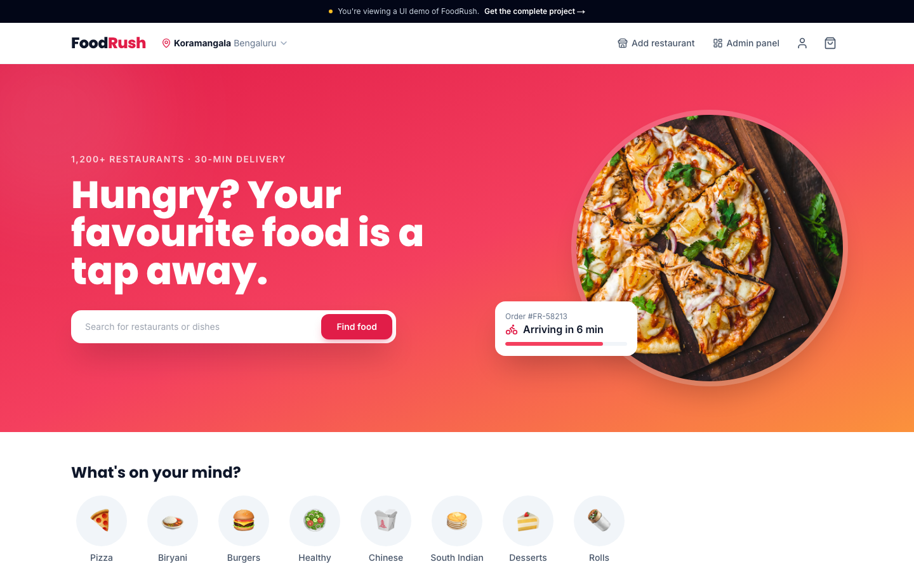
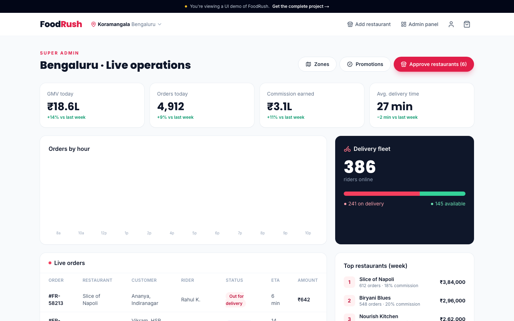
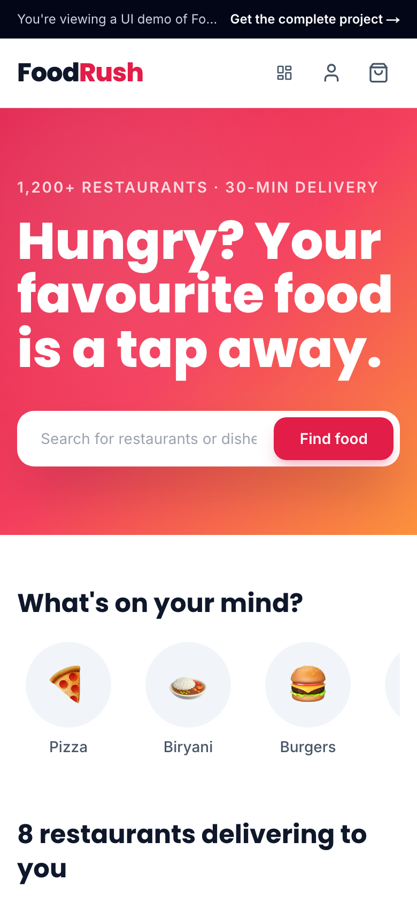

# Multi Vendor Food Delivery Software | Food Delivery Marketplace Development

**Naya Prayog Technologies** provides custom **Multi Vendor Food Delivery Software Development** services for startups, entrepreneurs, restaurant businesses, and food delivery companies.

We develop customised food delivery marketplace solutions that connect multiple restaurants, customers, delivery partners, and platform administrators through a centralised digital ecosystem.

Whether you want to launch a local food delivery marketplace, build a city-wide restaurant ordering platform, or establish a scalable multi-restaurant delivery business, we can develop a solution around your business model.

## What Is Multi Vendor Food Delivery Software?

Multi Vendor Food Delivery Software is a digital marketplace platform that allows multiple restaurants and food vendors to register, manage their menus, receive orders, and serve customers through one centralised food delivery system.

Unlike a single-restaurant ordering application, a multi-vendor platform supports independent restaurant accounts and centralised marketplace administration.

A complete solution can include:

- Customer food ordering application
- Restaurant and vendor management panel
- Delivery partner application
- Super admin dashboard
- Order management system
- Commission and revenue management
- Payment integration
- Backend APIs and database

Naya Prayog Technologies develops custom multi-vendor food delivery platforms based on business requirements and operational workflows.

## Multi Vendor Food Delivery Platform Architecture

A multi-restaurant food delivery marketplace generally involves four main user groups.

### 1. Customer Application

The customer application allows users to discover restaurants, browse menus, place food orders, and track deliveries.

Potential features include:

- Customer registration and login
- Profile management
- Location and delivery address management
- Restaurant discovery
- Nearby restaurant listings
- Restaurant categories
- Food menu browsing
- Food item customisation
- Search and filters
- Shopping cart
- Multiple restaurant ordering workflows
- Coupon and discount management
- Online payment and cash payment options where supported
- Order placement
- Order history
- Order status tracking
- Delivery tracking
- Ratings and reviews
- Favourite restaurants
- Push notifications

### 2. Restaurant and Vendor Panel

Each restaurant can have an individual dashboard to manage its marketplace operations.

Potential features include:

- Restaurant registration
- Vendor profile management
- Restaurant verification workflows
- Business information management
- Restaurant operating hours
- Food menu management
- Category and item management
- Food pricing and availability
- Add-ons and customisation
- Incoming order notifications
- Order acceptance and rejection
- Food preparation status
- Order history
- Restaurant offers and discounts
- Sales reports
- Commission and settlement summaries

### 3. Delivery Partner Application

The delivery partner application can support order pickup and delivery operations.

Potential features include:

- Delivery partner registration
- Profile and document management
- Availability management
- Online and offline status
- Delivery assignment
- Order acceptance
- Restaurant pickup details
- Customer delivery address
- Navigation and map integration
- Pickup confirmation
- Delivery status updates
- Location tracking
- Delivery history
- Earnings summaries
- Notifications

### 4. Super Admin Dashboard

The super admin dashboard provides centralised control over the marketplace.

Potential features include:

- Customer management
- Restaurant and vendor management
- Vendor approval and verification
- Delivery partner management
- Restaurant category management
- Food category management
- Order monitoring
- Order assignment
- Commission configuration
- Platform service charges
- Coupon and promotion management
- Payment transaction records
- Restaurant settlement management
- Customer support management
- Reports and analytics
- Platform configuration
- Role-based access management

## Essential Multi Vendor Food Delivery Features

### 1. Restaurant Registration and Onboarding

A vendor onboarding workflow can allow restaurants to apply for marketplace registration.

Potential capabilities include:

- Restaurant registration forms
- Business profile submission
- Restaurant document uploads
- Admin verification
- Vendor approval and rejection
- Restaurant activation and suspension
- Restaurant dashboard access

### 2. Multi-Restaurant Menu Management

Each restaurant can independently manage its food catalogue.

Potential capabilities include:

- Restaurant-specific menus
- Food categories
- Item descriptions and images
- Pricing management
- Food availability
- Customisation options
- Add-ons and extras
- Menu activation and deactivation

### 3. Order Management System

A centralised order management system can help manage customer orders across multiple restaurants.

Potential capabilities include:

- Order placement
- Restaurant-wise order processing
- Order confirmation
- Order acceptance and rejection
- Food preparation tracking
- Delivery assignment
- Order cancellation workflows
- Refund records where applicable
- Order history and reporting

### 4. Restaurant Commission Management

Marketplace owners can define commission structures for participating restaurants.

Potential capabilities include:

- Restaurant-wise commission configuration
- Percentage-based commissions
- Fixed commission rules
- Order-wise commission calculation
- Platform service charges
- Delivery charge configuration
- Commission reports
- Vendor earnings summaries

### 5. Vendor Payment and Settlement Management

A marketplace may require a dedicated settlement workflow for restaurant payments.

Potential capabilities include:

- Restaurant earning records
- Commission deductions
- Order-wise financial records
- Settlement summaries
- Payment status tracking
- Settlement history
- Reconciliation reports
- Payout management integration

Automated payouts depend on the selected payment provider and supported settlement APIs.

### 6. Delivery Management

The platform can provide tools for managing delivery operations across multiple restaurants.

Potential capabilities include:

- Delivery partner registration
- Delivery assignment
- Order pickup coordination
- Delivery status management
- Route and map integration
- Delivery charge configuration
- Delivery history
- Delivery performance reports

### 7. Offers and Promotional Management

Marketplace administrators and authorised restaurant vendors can manage promotional activities.

Potential capabilities include:

- Platform-wide coupons
- Restaurant-specific discounts
- First-order offers
- Promotional campaigns
- Minimum order discounts
- Customer-specific promotions
- Loyalty and reward programmes

### 8. Payment Management

Payment functionality can be integrated using supported payment providers.

Potential capabilities include:

- Online payment gateways
- UPI payments
- Card payments
- Net banking
- Digital wallets
- Cash on delivery
- Transaction records
- Payment status tracking
- Refund workflows where supported

### 9. Reports and Analytics

The marketplace owner can access centralised business reports.

Potential reports include:

- Total orders
- Restaurant-wise orders
- Customer activity
- Vendor sales
- Platform revenue
- Commission collection
- Delivery performance
- Payment summaries
- Settlement reports
- Order cancellation reports
- Monthly and yearly business analytics

## Types of Multi Vendor Food Delivery Platforms

### 1. Local Restaurant Marketplace

Launch a local food ordering marketplace connecting restaurants and customers within a particular city or region.

### 2. City-Wide Food Delivery Platform

Build a platform that connects multiple restaurants, customers, and delivery partners across a larger geographical area.

### 3. Restaurant Aggregator Platform

Develop a restaurant discovery and food ordering marketplace where independent restaurants manage their own menus and incoming orders.

### 4. Cloud Kitchen Marketplace

Create a platform where multiple cloud kitchens can list their food products and accept customer orders.

### 5. Franchise-Based Food Delivery Platform

Develop a marketplace with central administration and location-based operational management for a franchise or partner network.

### 6. White-Label Food Delivery Marketplace

Launch a branded food delivery platform with customised branding, vendor workflows, business rules, and required application modules.

## Web, Android, and iOS Development

Naya Prayog Technologies can develop a multi-platform food delivery ecosystem.

Potential deliverables include:

- Android customer application
- iOS customer application
- Android delivery partner application
- iOS delivery partner application
- Restaurant web dashboard
- Super admin web dashboard
- Customer web ordering platform
- Backend APIs
- Database architecture
- Cloud deployment

Technology selection depends on project requirements, performance expectations, and the agreed technical architecture.

## Multi Vendor Food Delivery Software Development Process

### 1. Business Model Analysis

Understand your marketplace model, restaurant onboarding process, commission structure, delivery operations, and revenue strategy.

### 2. UI/UX Design

Plan customer journeys, restaurant dashboards, delivery workflows, and central administration screens.

### 3. Platform Development

Develop the customer application, vendor panel, delivery partner application, backend services, and admin dashboard.

### 4. Third-Party Integrations

Integrate suitable payment gateways, mapping services, notifications, and other required external services.

### 5. Testing and Quality Assurance

Test restaurant onboarding, multi-vendor order workflows, payments, commissions, permissions, and delivery operations.

### 6. Deployment and Launch Support

Prepare the agreed applications, backend services, and administration systems for deployment.

The actual development process and deliverables depend on the agreed project scope.

## Why Choose Naya Prayog Technologies?

- Custom multi-vendor food delivery software development
- Restaurant marketplace development
- Android and iOS application development
- Restaurant and vendor dashboards
- Delivery partner applications
- Commission and revenue management workflows
- Custom backend APIs and admin panels
- Payment and third-party integrations
- Scalable marketplace architecture
- Business-specific software development

We focus on building practical technology solutions that help entrepreneurs and businesses establish and grow their own digital marketplaces.

## Our Related Software Development Services

- Multi Vendor Food Delivery Software Development
- Food Delivery App Development
- Restaurant Management Software Development
- Restaurant POS Software Development
- Grocery Delivery App Development
- Medicine Delivery App Development
- Multi Vendor E-commerce Marketplace Development
- Custom Mobile App Development
- Flutter App Development
- Custom Marketplace Software Development

## Frequently Asked Questions

### What is multi-vendor food delivery software?

It is a marketplace platform that allows multiple restaurants to register, manage menus, receive customer orders, and coordinate deliveries through one centralised system.

### What is the difference between single-restaurant and multi-vendor food delivery software?

A single-restaurant application serves one restaurant or business. A multi-vendor platform supports multiple independent restaurants operating through a shared marketplace.

### Can restaurants manage their own menus?

Yes. Individual restaurant dashboards can provide authorised vendors with tools to manage food categories, menu items, prices, availability, and incoming orders.

### Can the platform calculate restaurant commissions?

Yes. Restaurant-specific or order-based commission rules can be developed according to the marketplace's revenue model.

### Can I manage restaurant settlements?

A settlement management module can track vendor earnings, commission deductions, payment records, and settlement status. Automated payouts depend on payment provider capabilities.

### Can the platform include a delivery partner app?

Yes. A separate Android and iOS delivery partner application can be developed to manage delivery assignments, pickups, navigation, and delivery status.

### Can I launch a food delivery marketplace in my city?

Yes. Naya Prayog Technologies can help plan and develop a city-focused food delivery marketplace with restaurant onboarding, customer ordering, delivery management, and central administration.

### Do you develop Android, iOS, and web applications?

Yes. We provide mobile application development and web-based dashboard development for complete food delivery ecosystems.

## Discuss Your Multi Vendor Food Delivery Project

Looking for reliable **Multi Vendor Food Delivery Software Development** services?

Whether you are launching a restaurant marketplace, building a city-wide food delivery business, or expanding an existing food platform, Naya Prayog Technologies can help develop a customised solution.

**Naya Prayog Technologies**

- Website: https://nayaprayog.com/
- Email: [support@nayaprayog.com](mailto:support@nayaprayog.com)
- Phone / WhatsApp: +91 7991327022
- WhatsApp: https://wa.me/917991327022
- Portfolio: https://github.helloharendra.io

**Connect restaurants. Empower vendors. Build your own food delivery marketplace.**

---

## Repository Information

This repository showcases Naya Prayog Technologies' multi-vendor food delivery software development services and potential solution capabilities.

For customisation, pricing, implementation, or project enquiries, contact our team.

**Note:** This repository is a proprietary service and solution showcase. It does not grant permission to redistribute, resell, or commercially use Naya Prayog Technologies' proprietary materials or intellectual property.

<!-- screenshots -->
## Screenshots

**Home**

**Admin Dashboard**

<table>
  <tr>
    <td align="center" width="260"><b>Mobile View</b>  </td>
  </tr>
</table>
